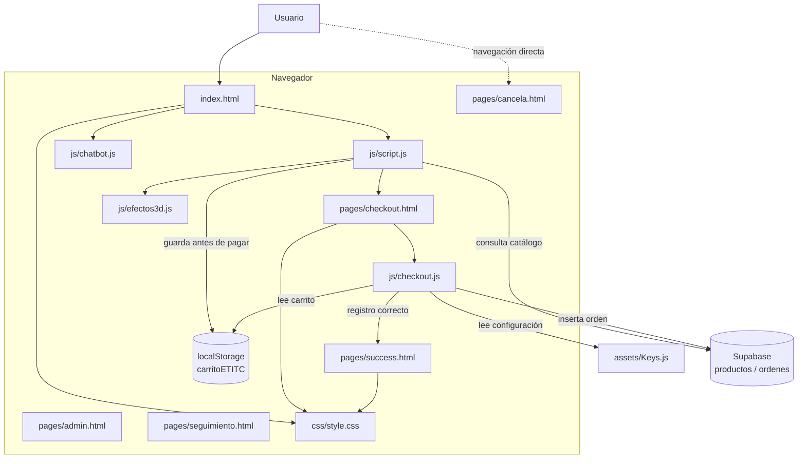

# ETITC Virtual Store

## Arquitectura

La aplicación es una tienda web estática que se ejecuta en el navegador. No tiene un servidor de aplicación propio ni un proceso de compilación configurado. Las páginas HTML presentan la interfaz; los módulos JavaScript gestionan el catálogo, el carrito, el checkout, los efectos visuales y el chatbot. Supabase es el servicio externo para consultar productos y guardar órdenes.



### Componentes y responsabilidades

- **Tienda (`index.html`, `js/script.js`):** el módulo consulta los productos en Supabase, renderiza el catálogo y gestiona las cantidades y el total del carrito. Al continuar al checkout, guarda el carrito en `localStorage` con la clave `carritoETITC`.
- **Checkout (`pages/checkout.html`, `js/checkout.js`):** recupera los artículos del carrito, calcula el total, valida el correo e inserta la orden en la tabla `ordenes`. Si Supabase confirma la inserción, elimina el carrito y navega a `pages/success.html`.
- **Chatbot (`js/chatbot.js`):** se carga desde `index.html`, crea el widget al abrir la página, acepta mensajes escritos y preguntas sugeridas, y responde con reglas locales basadas en palabras clave. Las preguntas sugeridas se muestran en una cuadrícula desplazable; la conversación puede desplazarse cuando acumula mensajes. El asistente no usa un servicio de IA ni envía conversaciones a un servidor.
- **Efectos visuales (`js/efectos3d.js`):** provee efectos de inclinación 3D, parallax y aparición, reutilizados por la tienda y el checkout.
- **Datos y configuración:** `js/script.js` configura su cliente Supabase en el propio módulo; `js/checkout.js` importa la URL y la clave pública desde `assets/Keys.js`. No se deben incluir claves secretas ni claves `service_role` en código cliente.
- **Páginas:** `index.html` permanece en la raíz para que el hosting estático la use como portada. Las páginas secundarias están agrupadas en `pages/`; sus rutas relativas regresan a los recursos compartidos de la raíz.
- **Estilos e imágenes:** `css/style.css` se comparte entre las páginas. Los recursos gráficos se agrupan en `assets/images/`; `css/success.css` permanece disponible pero no está enlazado.
- **Servicios externos:** Supabase JS, Google Fonts y Font Awesome se cargan desde CDN. El checkout registra un pago de prueba por llave Bre-B junto con una referencia numérica ingresada por el comprador; no se realiza ni se verifica una transferencia bancaria real.

### Flujo de compra

1. `index.html` carga `js/script.js`, que consulta los productos y genera el catálogo.
2. El usuario añade productos al carrito y ajusta las cantidades.
3. Al continuar al pago, el módulo guarda el carrito en `localStorage` y abre `pages/checkout.html`.
4. `js/checkout.js` recupera el carrito, calcula el total y procesa el formulario.
5. Si Supabase acepta la orden, se elimina el carrito y se muestra `pages/success.html`.

### Flujo del chatbot

1. `index.html` carga `js/chatbot.js` como módulo.
2. El módulo crea el botón flotante y el panel con preguntas frecuentes y campo de texto.
3. Al enviar una pregunta o seleccionar una sugerencia, el mensaje aparece en la conversación y se genera una respuesta local.
4. El panel se abre y se cierra con sus controles; Escape también lo cierra.

## Estructura del proyecto

```text
ETITC/
├── .vscode/settings.json
├── README.md
├── index.html
├── assets/
│   ├── Keys.js
│   └── images/
│       └── ETITC.png
├── css/
│   ├── cancel.css
│   ├── images/
│   │   └── Fondo 1.png
│   ├── style.css
│   └── success.css
├── js/
│   ├── admin.js
│   ├── chatbot.js
│   ├── checkout.js
│   ├── efectos3d.js
│   ├── script.js
│   └── seguimiento.js
└── pages/
    ├── admin.html
    ├── cancela.html
    ├── checkout.html
    ├── seguimiento.html
    └── success.html
```

## Código completo de los archivos

A continuación se incluye el contenido actual de cada archivo de código y configuración encontrado en el proyecto. Se omiten únicamente espacios al final de las líneas para la presentación Markdown; esto no modifica el comportamiento. Los recursos binarios permanecen como archivos independientes y no se pueden representar como código fuente.

### ``.vscode/settings.json``

````json
{
  "deno.enable": true,
  "deno.lint": true,
  "deno.enablePaths": ["./supabase/functions"]
}
````

### ``assets/Keys.js``

````javascript
// assets/Keys.js
const SUPABASE_KEYS = {
  url: "https://aeocbyaaeolffaccsfgj.supabase.co",
  anonKey: "sb_publishable_jw_FMN_9x6V75C3DDx9-KQ__4Q3tbbW"
};

export default SUPABASE_KEYS;
````

### ``cancela.html``

````html
<!DOCTYPE html>
<html lang="es">
<head>
   <meta charset="UTF-8">
   <meta name="viewport" content="width=device-width, initial-scale=1.0">
   <title>Daniel Salinas | Pago Cancelado</title>
   <link rel="stylesheet" href="../css/cancel.css">
   <script src="https://kit.fontawesome.com/73f851add2.js" crossorigin="anonymous"></script>
</head>
<body>
  <div class="card-status">
    <i class="fa-solid fa-circle-xmark icon-status"></i>
    <p class="title-status">No se pudo procesar tu pago</p>
    <p class="sub-status">El proceso fue cancelado o la tarjeta fue rechazada.</p>
    <a href="../index.html" class="btn-home">Volver a intentar</a>
  </div>
</body>
</html>
````

### ``checkout.html``

````html
<!DOCTYPE html>
<html lang="es">
<head>
  <meta charset="UTF-8">
  <meta name="viewport" content="width=device-width, initial-scale=1.0">
  <meta name="theme-color" content="#12181b">
  <title>Pago con Nequi | ETITC Store</title>
  <link rel="stylesheet" href="css/style.css">
  <link rel="preconnect" href="https://fonts.googleapis.com">
  <link rel="preconnect" href="https://fonts.gstatic.com" crossorigin>
  <link href="https://fonts.googleapis.com/css2?family=Poppins:wght@300;400;500;600;700&display=swap" rel="stylesheet">
  <script src="https://kit.fontawesome.com/73f851add2.js" crossorigin="anonymous"></script>
</head>
<body>

  <main class="container">
    <section class="checkout-section reveal" data-tilt data-tilt-max="3" data-tilt-scale="1.01" data-tilt-pausar-foco>
      <h2><i class="fa-solid fa-qrcode"></i> Pago con Nequi</h2>
      <p class="checkout-subtitle">
        Escanea el código QR o realiza la transferencia al número de pruebas para validar tu pedido.
      </p>

      <div class="qr-container">
        

        <div class="nequi-alt-info">
          <p>¿Problemas con el QR?</p>
          <p>Transfiere directo al Nequi: <strong class="nequi-phone">300 123 4567</strong></p>
        </div>
      </div>

      <div class="resumen-compra">
        <p>Monto a Transferir: <strong id="checkout-total" class="total-monto">$0</strong></p>
      </div>

      <form id="checkout-form">
        <div class="form-group">
          <label for="nombre">Nombre Completo</label>
          <input type="text" id="nombre" placeholder="Ej. Juan Pérez" autocomplete="name" required>
        </div>

        <div class="form-group">
          <label for="correo">Correo Electrónico</label>
          <input
            type="email"
            id="correo"
            placeholder="tucorreo@gmail.com"
            autocomplete="email"
            inputmode="email"
            aria-describedby="correo-error"
            required
          >
          <small id="correo-error" class="form-error" role="alert"></small>
        </div>

        <div class="form-group">
          <label for="comprobante">Número de Aprobación / Referencia Nequi</label>
          <input type="text" id="comprobante" placeholder="Ej. M1234567" minlength="6" required>
        </div>

        <button type="submit" id="btn-confirmar-pago" class="btn-nequi">Verificar y Finalizar Pago</button>
      </form>

      <a href="index.html" class="volver-tienda"><i class="fa-solid fa-arrow-left"></i> Volver a la tienda</a>
    </section>
  </main>

  <script src="https://cdn.jsdelivr.net/npm/@supabase/supabase-js@2"></script>
  <script type="module" src="./js/checkout.js"></script>
</body>
</html>
````

### ``css/cancel.css``

````css
body {
  margin: 0;
  height: 100vh;
  display: flex;
  justify-content: center;
  align-items: center;
  font-family: 'Poppins', sans-serif;
  background-color: #fcf3f3;
}

.card-status {
  background-color: #ffffff;
  padding: 40px;
  border-radius: 16px;
  box-shadow: 0 10px 25px rgba(0, 0, 0, 0.05);
  text-align: center;
  max-width: 400px;
  width: 90%;
}

.icon-status {
  color: #e74c3c;
  font-size: 5rem;
  margin-bottom: 20px;
}

.title-status {
  color: #2c3e50;
  font-size: 1.5rem;
  font-weight: 700;
  margin-bottom: 10px;
}

.sub-status {
  color: #7f8c8d;
  font-size: 0.95rem;
  margin-bottom: 25px;
}

.btn-home {
  display: inline-block;
  padding: 12px 30px;
  background-color: #e74c3c;
  color: #ffffff;
  text-decoration: none;
  border-radius: 25px;
  font-weight: 600;
  transition: background-color 0.3s ease;
}

.btn-home:hover {
  background-color: #c0392b;
}
````

### ``css/style.css``

````css
/* =====================================================================
   ETITC Virtual Store — style.css
   Fuente Poppins: se carga con <link> en cada HTML (sin @import bloqueante).
   Animaciones: solo transform / opacity (GPU). Efectos pesados se reducen en móvil.
   ===================================================================== */

:root {
  --green-primary: #2ecc71;
  --green-light: #18281e;
  --green-hover: #27ae60;
  --bg-color: #12181b;
  --card-bg: #1a2126;
  --text-color: #f1f2f6;
  --text-muted: #a4b0be;
  --border-color: #2c3a47;
  --border-radius: 12px;

  /* Nuevos tokens */
  --nequi: #e3007b;
  --nequi-dark: #b00060;
  --glass-bg: rgba(26, 33, 38, 0.62);
  --glass-border: rgba(255, 255, 255, 0.09);
  --ease-out: cubic-bezier(0.22, 1, 0.36, 1);
}

* {
  margin: 0;
  padding: 0;
  box-sizing: border-box;
  text-decoration: none;
  list-style: none;
}

html {
  scroll-behavior: smooth;
  scroll-padding-top: 90px;
}

body {
  font-family: 'Poppins', sans-serif;
  background-color: var(--bg-color);
  color: var(--text-color);
  line-height: 1.6;
  overflow-x: hidden;
}

/* ---------- Fondo "aurora" (2 orbes con deriva suave, solo transform) ---------- */
body::before,
body::after {
  content: "";
  position: fixed;
  z-index: -1;
  pointer-events: none;
  width: 70vmax;
  height: 70vmax;
  border-radius: 50%;
  will-change: transform;
}

body::before {
  top: -28vmax;
  left: -22vmax;
  background: radial-gradient(circle, rgba(46, 204, 113, 0.2), transparent 65%);
  animation: deriva 24s ease-in-out infinite alternate;
}

body::after {
  bottom: -32vmax;
  right: -26vmax;
  background: radial-gradient(circle, rgba(227, 0, 123, 0.13), transparent 65%);
  animation: deriva 30s ease-in-out infinite alternate-reverse;
}

@keyframes deriva {
  from { transform: translate3d(0, 0, 0) scale(1); }
  to   { transform: translate3d(9vmax, 6vmax, 0) scale(1.15); }
}

.container {
  max-width: 1200px;
  margin: 0 auto;
  padding: 0 20px;
}

/* ===================== Header & Menu Nav (glass) ===================== */
.header {
  position: sticky;
  top: 0;
  z-index: 900;
  background: rgba(18, 24, 27, 0.65);
  -webkit-backdrop-filter: blur(16px) saturate(140%);
  backdrop-filter: blur(16px) saturate(140%);
  border-bottom: 1px solid var(--glass-border);
}

.nav-container {
  display: flex;
  justify-content: space-between;
  align-items: center;
  padding: 14px 0;
}

.logo {
  display: flex;
  align-items: center;
  gap: 12px;
  font-size: 26px;
  font-weight: 700;
  color: var(--text-color);
}

.logo span {
  color: var(--green-primary);
}

.logo img {
  width: 45px;
  height: 45px;
  object-fit: contain;
  transition: transform 0.6s var(--ease-out);
}

.logo:hover img {
  transform: rotateY(360deg);
}

.navbar ul {
  display: flex;
  gap: 8px;
}

.navbar ul li a {
  position: relative;
  display: block;
  padding: 6px 14px;
  color: var(--text-color);
  font-weight: 500;
  border-radius: 20px;
  transition: color 0.3s, background-color 0.3s;
}

.navbar ul li a:hover {
  color: var(--green-primary);
  background-color: rgba(46, 204, 113, 0.1);
}

#menu, .menu-icono {
  display: none;
}

/* ===================== Hero 3D ===================== */
.hero {
  padding: 70px 0 40px;
}

.hero-grid {
  display: grid;
  grid-template-columns: 1.1fr 0.9fr;
  align-items: center;
  gap: 40px;
}

.hero-txt {
  text-align: left;
}

.hero-badge {
  display: inline-flex;
  align-items: center;
  gap: 8px;
  padding: 6px 16px;
  margin-bottom: 18px;
  font-size: 0.85rem;
  font-weight: 500;
  color: var(--green-primary);
  background: rgba(46, 204, 113, 0.1);
  border: 1px solid rgba(46, 204, 113, 0.3);
  border-radius: 25px;
}

.hero-txt h1 {
  font-size: clamp(2.2rem, 5vw, 3.6rem);
  line-height: 1.1;
  margin-bottom: 18px;
}

.hero-txt h1 span {
  background: linear-gradient(90deg, var(--green-primary), #7bed9f);
  -webkit-background-clip: text;
  background-clip: text;
  -webkit-text-fill-color: transparent;
  color: var(--green-primary);
}

.hero-txt p {
  font-size: 1.1rem;
  color: var(--text-muted);
  max-width: 520px;
  margin: 0 0 30px 0;
}

/* Escena 3D: pila de capas de cristal */
.hero-3d {
  perspective: 1100px;
  height: 380px;
  display: grid;
  place-items: center;
}

.hero-float {
  animation: flotar 7s ease-in-out infinite;
}

@keyframes flotar {
  0%, 100% { transform: translateY(-8px); }
  50%      { transform: translateY(10px); }
}

.hero-stack {
  --hrx: -12deg;
  --hry: 18deg;
  position: relative;
  width: 270px;
  height: 270px;
  transform-style: preserve-3d;
  transform: rotateX(var(--hrx)) rotateY(var(--hry));
  transition: transform 0.35s ease-out;
}

.hero-layer {
  position: absolute;
  inset: 0;
  border-radius: 28px;
  border: 1px solid var(--glass-border);
}

.hero-layer.l1 {
  transform: translateZ(-90px) scale(1.08);
  background: linear-gradient(135deg, rgba(46, 204, 113, 0.5), rgba(24, 40, 30, 0.2));
  box-shadow: 0 40px 80px rgba(46, 204, 113, 0.18);
}

.hero-layer.l2 {
  transform: translateZ(-30px);
  background:
    linear-gradient(rgba(255, 255, 255, 0.05) 1px, transparent 1px) 0 0 / 28px 28px,
    linear-gradient(90deg, rgba(255, 255, 255, 0.05) 1px, transparent 1px) 0 0 / 28px 28px,
    rgba(26, 33, 38, 0.7);
}

.hero-layer.l3 {
  inset: 26px;
  transform: translateZ(40px);
  display: grid;
  place-items: center;
  font-size: 4.2rem;
  color: var(--green-primary);
  background: linear-gradient(145deg, rgba(255, 255, 255, 0.14), rgba(255, 255, 255, 0.03));
  border-color: rgba(255, 255, 255, 0.18);
  box-shadow: inset 0 1px 0 rgba(255, 255, 255, 0.2), 0 20px 40px rgba(0, 0, 0, 0.35);
}

.hero-chip {
  position: absolute;
  display: grid;
  place-items: center;
  width: 54px;
  height: 54px;
  font-size: 1.3rem;
  color: #fff;
  border-radius: 16px;
  background: linear-gradient(135deg, var(--green-primary), var(--green-hover));
  box-shadow: 0 14px 28px rgba(0, 0, 0, 0.4);
  transform: translateZ(120px);
}

.hero-chip.c1 { top: -14px; right: -18px; }
.hero-chip.c2 { bottom: 26px; left: -26px; background: linear-gradient(135deg, #e3007b, #ff5fb0); transform: translateZ(95px); }
.hero-chip.c3 { bottom: -18px; right: 34px; background: linear-gradient(135deg, #3498db, #74b9ff); transform: translateZ(140px); }

/* ===================== Botones ===================== */
.btn-primary {
  position: relative;
  overflow: hidden;
  display: inline-block;
  padding: 12px 32px;
  background: linear-gradient(135deg, var(--green-primary), var(--green-hover));
  color: #ffffff;
  border-radius: 25px;
  font-weight: 600;
  border: none;
  cursor: pointer;
  text-align: center;
  box-shadow: 0 8px 20px rgba(46, 204, 113, 0.25);
  transition: transform 0.3s var(--ease-out), box-shadow 0.3s ease;
}

.btn-primary::after {
  content: "";
  position: absolute;
  top: 0;
  left: -75%;
  width: 50%;
  height: 100%;
  background: linear-gradient(120deg, transparent, rgba(255, 255, 255, 0.35), transparent);
  transform: skewX(-20deg);
}

.btn-primary:hover {
  transform: translateY(-3px);
  box-shadow: 0 14px 28px rgba(46, 204, 113, 0.35);
}

.btn-primary:hover::after {
  left: 130%;
  transition: left 0.7s ease;
}

.btn-primary:active {
  transform: translateY(0) scale(0.98);
}

/* ===================== Tilt genérico ===================== */
[data-tilt] {
  position: relative;
  transform-style: preserve-3d;
  transform: perspective(1000px) rotateX(0deg) rotateY(0deg) scale(1);
  transition: transform 0.6s var(--ease-out), box-shadow 0.4s ease, border-color 0.3s ease;
}

[data-tilt].is-tilting {
  transition: transform 0.08s linear, box-shadow 0.25s ease, border-color 0.3s ease;
  will-change: transform;
}

/* Brillo (glare) que sigue al cursor */
[data-tilt]::after {
  content: "";
  position: absolute;
  inset: 0;
  border-radius: inherit;
  pointer-events: none;
  opacity: 0;
  background: radial-gradient(circle at var(--mx, 50%) var(--my, 0%), rgba(255, 255, 255, 0.16), transparent 55%);
  transition: opacity 0.35s ease;
}

[data-tilt].is-tilting::after {
  opacity: 1;
}

/* ===================== Beneficios ===================== */
.beneficios {
  padding: 60px 0;
  text-align: center;
}

.beneficios h2,
.planes-section h2 {
  position: relative;
  font-size: 2rem;
  margin-bottom: 48px;
}

.beneficios h2::after,
.planes-section h2::after {
  content: "";
  display: block;
  width: 56px;
  height: 4px;
  margin: 12px auto 0;
  border-radius: 4px;
  background: linear-gradient(90deg, var(--green-primary), #7bed9f);
}

.beneficios-grid {
  display: flex;
  gap: 20px;
  flex-wrap: wrap;
}

.beneficio-card {
  flex: 1;
  min-width: 250px;
  background: linear-gradient(160deg, rgba(36, 46, 53, 0.75), rgba(22, 28, 33, 0.8));
  padding: 34px 22px;
  border-radius: 16px;
  border: 1px solid var(--glass-border);
  box-shadow: var(--sx, 0px) var(--sy, 10px) 30px rgba(0, 0, 0, 0.35);
}

.beneficio-card i {
  display: inline-block;
  font-size: 2.5rem;
  color: var(--green-primary);
  margin-bottom: 15px;
  transition: transform 0.4s var(--ease-out), text-shadow 0.4s ease;
}

.beneficio-card.is-tilting i {
  transform: translateZ(46px);
  text-shadow: 0 0 22px rgba(46, 204, 113, 0.7);
}

.beneficio-card h3 {
  transition: transform 0.4s var(--ease-out);
}

.beneficio-card.is-tilting h3 {
  transform: translateZ(24px);
}

/* ===================== Catálogo de Productos ===================== */
.planes-section {
  padding: 60px 0;
}

.planes-section h2 {
  text-align: center;
}

.productos-container {
  display: grid;
  grid-template-columns: repeat(auto-fill, minmax(260px, 1fr));
  gap: 28px;
}

.cargando {
  grid-column: 1 / -1;
  text-align: center;
  color: var(--text-muted);
  padding: 30px 0;
}

.producto-card {
  background: linear-gradient(160deg, rgba(36, 46, 53, 0.85), rgba(22, 28, 33, 0.92));
  border-radius: 16px;
  border: 1px solid var(--glass-border);
  display: flex;
  flex-direction: column;
  box-shadow: var(--sx, 0px) var(--sy, 10px) 30px rgba(0, 0, 0, 0.4);
}

.producto-card.is-tilting {
  border-color: rgba(46, 204, 113, 0.65);
  box-shadow:
    var(--sx, 0px) var(--sy, 18px) 40px rgba(0, 0, 0, 0.55),
    0 0 36px rgba(46, 204, 113, 0.14);
}

@media (hover: hover) and (pointer: fine) {
  .producto-card:not(.is-tilting):hover {
    border-color: rgba(46, 204, 113, 0.5);
  }
}

.producto-media {
  overflow: hidden;
  border-radius: 15px 15px 0 0;
  background: #0f1417;
}

.producto-card img {
  display: block;
  width: 100%;
  height: 200px;
  object-fit: cover;
  transition: transform 0.7s var(--ease-out);
}

.producto-card.is-tilting img {
  transform: scale(1.08);
}

.producto-info {
  padding: 20px;
  display: flex;
  flex-direction: column;
  flex-grow: 1;
}

.producto-title {
  font-size: 1.1rem;
  margin-bottom: 10px;
  color: var(--text-color);
  transition: transform 0.4s var(--ease-out);
}

.producto-precio {
  font-size: 1.25rem;
  color: var(--green-primary);
  font-weight: 700;
  margin-bottom: 15px;
  transition: transform 0.4s var(--ease-out), text-shadow 0.4s ease;
}

/* Elementos que "saltan" hacia el usuario al inclinar la tarjeta */
.producto-card.is-tilting .producto-title { transform: translateZ(26px); }
.producto-card.is-tilting .producto-precio { transform: translateZ(38px); text-shadow: 0 0 18px rgba(46, 204, 113, 0.55); }
.producto-card.is-tilting .btn-comprar { transform: translateZ(30px); }

.btn-comprar {
  margin-top: auto;
  padding: 11px;
  background: linear-gradient(135deg, var(--green-primary), var(--green-hover));
  color: #fff;
  border: none;
  border-radius: 8px;
  font-weight: 600;
  cursor: pointer;
  box-shadow: 0 8px 18px rgba(46, 204, 113, 0.2);
  transition: transform 0.4s var(--ease-out), box-shadow 0.3s, filter 0.3s;
}

.btn-comprar:hover {
  filter: brightness(1.1);
  box-shadow: 0 12px 24px rgba(46, 204, 113, 0.35);
}

.btn-comprar:active {
  filter: brightness(0.95);
}

.btn-comprar.agregado {
  animation: pulso 0.5s var(--ease-out);
}

@keyframes pulso {
  0%   { box-shadow: 0 0 0 0 rgba(46, 204, 113, 0.7); }
  100% { box-shadow: 0 0 0 16px rgba(46, 204, 113, 0); }
}

/* ===================== Entrada animada (reveal) ===================== */
.js-3d .reveal {
  opacity: 0;
}

.js-3d .reveal.visible {
  opacity: 1;
  /* "backwards": al terminar no retiene el transform, así el tilt inline sigue funcionando */
  animation: entrada 0.85s var(--ease-out) backwards;
  animation-delay: calc(var(--i, 0) * 70ms);
}

@keyframes entrada {
  from { opacity: 0; transform: perspective(900px) translateY(36px) rotateX(-12deg) scale(0.96); }
  to   { opacity: 1; transform: perspective(900px) translateY(0) rotateX(0deg) scale(1); }
}

/* ===================== Contacto ===================== */
.contact {
  padding: 60px 0;
}

.contact-content {
  background:
    radial-gradient(circle at 15% 0%, rgba(46, 204, 113, 0.18), transparent 55%),
    var(--glass-bg);
  -webkit-backdrop-filter: blur(14px);
  backdrop-filter: blur(14px);
  border: 1px solid rgba(46, 204, 113, 0.45);
  border-radius: 18px;
  padding: 44px 20px;
  text-align: center;
  box-shadow: 0 20px 50px rgba(0, 0, 0, 0.35);
}

.contact-content h2 {
  margin-bottom: 20px;
}

.contact form {
  display: flex;
  justify-content: center;
  gap: 10px;
  max-width: 500px;
  margin: 0 auto;
}

.contact input {
  flex-grow: 1;
  padding: 12px 20px;
  background-color: rgba(18, 24, 27, 0.8);
  color: var(--text-color);
  border: 1px solid var(--border-color);
  border-radius: 25px;
  outline: none;
  transition: border-color 0.3s, box-shadow 0.3s;
}

.contact input:focus {
  border-color: var(--green-primary);
  box-shadow: 0 0 0 4px rgba(46, 204, 113, 0.15);
}

.contact input::placeholder {
  color: var(--text-muted);
}

.btn-submit {
  padding: 12px 25px;
  background: linear-gradient(135deg, var(--green-primary), var(--green-hover));
  color: white;
  border: none;
  border-radius: 25px;
  cursor: pointer;
  font-weight: 600;
  transition: transform 0.3s var(--ease-out), box-shadow 0.3s;
}

.btn-submit:hover {
  transform: translateY(-2px);
  box-shadow: 0 10px 22px rgba(46, 204, 113, 0.3);
}

/* ===================== Footer ===================== */
.footer-container {
  text-align: center;
  padding: 30px 0;
  border-top: 1px solid var(--glass-border);
  color: var(--text-muted);
}

/* ===================== Carrito Flotante ===================== */
.carrito-widget {
  position: fixed;
  bottom: calc(25px + env(safe-area-inset-bottom, 0px));
  right: 25px;
  z-index: 1000;
}

.btn-carrito {
  background: linear-gradient(135deg, var(--green-primary), var(--green-hover));
  color: #fff;
  border: none;
  width: 60px;
  height: 60px;
  border-radius: 50%;
  font-size: 1.4rem;
  cursor: pointer;
  position: relative;
  box-shadow: 0 10px 25px rgba(46, 204, 113, 0.35), 0 4px 15px rgba(0, 0, 0, 0.4);
  transition: transform 0.35s var(--ease-out);
}

.btn-carrito::before {
  content: "";
  position: absolute;
  inset: 0;
  border-radius: 50%;
  border: 2px solid var(--green-primary);
  animation: anillo 2.8s ease-out infinite;
  pointer-events: none;
}

@keyframes anillo {
  0%   { transform: scale(1);   opacity: 0.7; }
  100% { transform: scale(1.7); opacity: 0; }
}

.btn-carrito:hover {
  transform: scale(1.1) rotate(-6deg);
}

.btn-carrito:active {
  transform: scale(0.95);
}

#carrito-contador {
  position: absolute;
  top: -5px;
  right: -5px;
  background-color: #e74c3c;
  color: white;
  border-radius: 50%;
  padding: 2px 8px;
  font-size: 0.8rem;
  font-weight: bold;
  box-shadow: 0 4px 10px rgba(231, 76, 60, 0.5);
}

#carrito-contador.bump {
  animation: rebote 0.45s var(--ease-out);
}

@keyframes rebote {
  0%   { transform: scale(1); }
  40%  { transform: scale(1.5); }
  100% { transform: scale(1); }
}

.carrito-modal {
  position: absolute;
  bottom: 74px;
  right: 0;
  width: min(340px, calc(100vw - 50px));
  background-color: var(--glass-bg);
  -webkit-backdrop-filter: blur(18px) saturate(150%);
  backdrop-filter: blur(18px) saturate(150%);
  border: 1px solid var(--glass-border);
  border-radius: 16px;
  padding: 20px;
  box-shadow: 0 24px 60px rgba(0, 0, 0, 0.6);
  transform-origin: bottom right;
  animation: abrirCarrito 0.4s var(--ease-out);
}

@keyframes abrirCarrito {
  from { opacity: 0; transform: perspective(700px) rotateX(-16deg) translateY(16px) scale(0.94); }
  to   { opacity: 1; transform: perspective(700px) rotateX(0deg) translateY(0) scale(1); }
}

.carrito-modal.oculto {
  display: none;
}

.carrito-modal h3 {
  margin-bottom: 15px;
  border-bottom: 1px solid var(--glass-border);
  padding-bottom: 10px;
}

#carrito-lista {
  max-height: 200px;
  overflow-y: auto;
  margin-bottom: 15px;
}

.item-carrito {
  display: flex;
  justify-content: space-between;
  align-items: center;
  margin-bottom: 12px;
  font-size: 0.9rem;
  border-bottom: 1px dashed var(--border-color);
  padding-bottom: 8px;
}

.item-carrito span {
  flex-grow: 1;
  padding-right: 10px;
}

.btn-eliminar-uno {
  background: none;
  border: none;
  color: #e74c3c;
  cursor: pointer;
  font-size: 1.1rem;
  transition: color 0.2s, transform 0.2s;
}

.btn-eliminar-uno:hover {
  color: #ff6b5b;
  transform: scale(1.2);
}

.carrito-resumen {
  border-top: 1px solid var(--glass-border);
  padding-top: 15px;
  text-align: right;
}

.carrito-resumen #btn-pagar {
  width: 100%;
  margin-top: 10px;
  padding: 10px;
  color: white;
  border-radius: 8px;
  font-weight: 600;
}

/* ===================== CHECKOUT NEQUI (glass 3D) ===================== */
.checkout-section {
  position: relative;
  max-width: 550px;
  margin: 40px auto;
  background:
    radial-gradient(circle at 85% 0%, rgba(227, 0, 123, 0.16), transparent 50%),
    var(--glass-bg);
  -webkit-backdrop-filter: blur(18px) saturate(140%);
  backdrop-filter: blur(18px) saturate(140%);
  border: 1px solid var(--glass-border);
  border-radius: 20px;
  padding: 32px;
  box-shadow: var(--sx, 0px) var(--sy, 24px) 60px rgba(0, 0, 0, 0.55);
}

/* Borde luminoso con degradado */
.checkout-section::before {
  content: "";
  position: absolute;
  inset: -1px;
  border-radius: inherit;
  padding: 1px;
  background: linear-gradient(145deg, rgba(227, 0, 123, 0.7), transparent 40%, transparent 60%, rgba(46, 204, 113, 0.5));
  -webkit-mask: linear-gradient(#000 0 0) content-box, linear-gradient(#000 0 0);
  -webkit-mask-composite: xor;
  mask: linear-gradient(#000 0 0) content-box exclude, linear-gradient(#000 0 0);
  pointer-events: none;
}

.checkout-section h2 {
  display: block;
  margin-bottom: 10px;
  text-align: center;
  color: var(--nequi);
  transition: transform 0.4s var(--ease-out);
}

.checkout-subtitle {
  text-align: center;
  color: var(--text-muted);
  font-size: 0.9rem;
  margin-bottom: 15px;
}

.qr-container {
  text-align: center;
  background-color: #fff;
  padding: 15px;
  border-radius: 14px;
  margin: 15px 0;
  box-shadow: 0 18px 40px rgba(0, 0, 0, 0.4);
  transition: transform 0.45s var(--ease-out);
}

.qr-container img {
  width: 200px;
  max-width: 100%;
  height: 200px;
  object-fit: contain;
}

.nequi-alt-info {
  margin-top: 10px;
  padding-top: 10px;
  border-top: 1px dashed #ddd;
  color: #333;
  font-size: 0.9rem;
}

.nequi-phone {
  color: var(--nequi);
  font-size: 1.1rem;
}

.form-group {
  margin-bottom: 18px;
}

.form-group label {
  display: block;
  margin-bottom: 6px;
  font-weight: 500;
}

.form-group input {
  width: 100%;
  padding: 12px 14px;
  background-color: rgba(18, 24, 27, 0.75);
  border: 1px solid var(--border-color);
  border-radius: 10px;
  color: var(--text-color);
  font-size: 0.95rem;
  outline: none;
  transition: border-color 0.3s, box-shadow 0.3s;
}

.form-group input:focus {
  border-color: var(--nequi);
  box-shadow: 0 0 0 4px rgba(227, 0, 123, 0.16);
}

.form-group input.input-error {
  border-color: #e74c3c;
  box-shadow: 0 0 0 4px rgba(231, 76, 60, 0.18);
  animation: temblor 0.4s ease;
}

@keyframes temblor {
  0%, 100% { transform: translateX(0); }
  25%      { transform: translateX(-6px); }
  75%      { transform: translateX(6px); }
}

.form-error {
  display: block;
  min-height: 1.2em;
  margin-top: 6px;
  font-size: 0.82rem;
  color: #ff7675;
}

.resumen-compra {
  background-color: rgba(18, 24, 27, 0.7);
  padding: 15px;
  border-radius: 12px;
  margin-bottom: 15px;
  border: 1px solid var(--glass-border);
  text-align: center;
  transition: transform 0.45s var(--ease-out);
}

.total-monto {
  color: var(--nequi);
  font-size: 1.2rem;
}

.btn-nequi {
  position: relative;
  overflow: hidden;
  background: linear-gradient(135deg, var(--nequi), #ff3fa0);
  color: white;
  border: none;
  padding: 13px;
  border-radius: 25px;
  font-weight: 600;
  width: 100%;
  cursor: pointer;
  font-size: 1rem;
  box-shadow: 0 12px 26px rgba(227, 0, 123, 0.35);
  transition: transform 0.45s var(--ease-out), box-shadow 0.3s, filter 0.3s;
}

.btn-nequi:hover:not(:disabled) {
  filter: brightness(1.08);
  box-shadow: 0 16px 32px rgba(227, 0, 123, 0.5);
}

.btn-nequi:active:not(:disabled) {
  filter: brightness(0.95);
}

.btn-nequi:disabled {
  cursor: progress;
  opacity: 0.85;
}

/* Barrido de luz mientras se verifica el pago */
.btn-nequi:disabled::after {
  content: "";
  position: absolute;
  top: 0;
  left: -60%;
  width: 50%;
  height: 100%;
  background: linear-gradient(120deg, transparent, rgba(255, 255, 255, 0.35), transparent);
  animation: barrido 1.2s linear infinite;
}

@keyframes barrido {
  to { left: 130%; }
}

.volver-tienda {
  display: block;
  margin-top: 16px;
  text-align: center;
  font-size: 0.9rem;
  color: var(--text-muted);
  transition: color 0.3s;
}

.volver-tienda:hover {
  color: var(--green-primary);
}

/* Elementos del checkout que "saltan" al inclinar */
.checkout-section.is-tilting h2 { transform: translateZ(30px); }
.checkout-section.is-tilting .qr-container { transform: translateZ(42px); }
.checkout-section.is-tilting .resumen-compra { transform: translateZ(22px); }
.checkout-section.is-tilting .btn-nequi { transform: translateZ(28px); }

/* ===================== Responsive ===================== */
@media (max-width: 900px) {
  .hero-grid {
    grid-template-columns: 1fr;
    text-align: center;
  }

  .hero-txt {
    text-align: center;
  }

  .hero-txt p {
    margin: 0 auto 30px auto;
  }

  .hero-3d {
    height: 330px;
  }
}

@media (max-width: 768px) {
  /* Menos blur = menos coste de GPU en móviles */
  .header,
  .contact-content,
  .carrito-modal,
  .checkout-section {
    -webkit-backdrop-filter: blur(8px);
    backdrop-filter: blur(8px);
  }

  body::before,
  body::after {
    animation-duration: 40s;
  }

  .menu-icono {
    display: block;
    font-size: 24px;
    color: var(--text-color);
    cursor: pointer;
  }

  .navbar {
    position: absolute;
    top: 100%;
    left: 0;
    right: 0;
    background-color: rgba(26, 33, 38, 0.96);
    border-bottom: 1px solid var(--glass-border);
    display: none;
    box-shadow: 0 10px 20px rgba(0, 0, 0, 0.5);
  }

  .navbar ul {
    flex-direction: column;
    padding: 20px;
    text-align: center;
  }

  #menu:checked ~ .navbar {
    display: block;
  }

  .contact form {
    flex-direction: column;
  }

  .hero {
    padding-top: 40px;
  }

  .checkout-section {
    margin: 24px auto;
    padding: 24px 18px;
  }
}

@media (max-width: 520px) {
  .hero-3d {
    height: 270px;
    transform: scale(0.74);
  }
}

/* En táctil no hay cursor: la escena del hero gira sola, suave */
@media (hover: none), (pointer: coarse) {
  .hero-stack {
    animation: giro 12s ease-in-out infinite;
  }
}

@keyframes giro {
  0%, 100% { transform: rotateX(-12deg) rotateY(-20deg); }
  50%      { transform: rotateX(-8deg) rotateY(22deg); }
}

/* Accesibilidad: sin movimiento si el usuario lo pide */
@media (prefers-reduced-motion: reduce) {
  *,
  *::before,
  *::after {
    animation: none !important;
    transition-duration: 0.01ms !important;
    scroll-behavior: auto !important;
  }

  .js-3d .reveal {
    opacity: 1;
  }
}

/* ===================== Chatbot ===================== */
.chatbot-widget {
  position: fixed;
  left: 24px;
  bottom: calc(24px + env(safe-area-inset-bottom, 0px));
  z-index: 1001;
  font-family: 'Poppins', sans-serif;
}

.btn-chatbot {
  position: relative;
  display: grid;
  place-items: center;
  width: 60px;
  height: 60px;
  border: 0;
  border-radius: 50%;
  background: linear-gradient(135deg, var(--green-primary), var(--green-hover));
  color: #fff;
  font-size: 1.35rem;
  cursor: pointer;
  box-shadow: 0 10px 25px rgba(46, 204, 113, 0.3), 0 4px 15px rgba(0, 0, 0, 0.4);
  transition: transform 0.25s var(--ease-out), filter 0.25s;
}

.btn-chatbot:hover {
  transform: translateY(-3px) scale(1.04);
  filter: brightness(1.08);
}

.btn-chatbot:focus-visible,
.btn-cerrar-chat:focus-visible,
.chat-suggestion-chip:focus-visible,
.chat-send-btn:focus-visible {
  outline: 3px solid #fff;
  outline-offset: 3px;
}

.chatbot-tooltip {
  position: absolute;
  left: 70px;
  width: max-content;
  padding: 7px 11px;
  border: 1px solid var(--glass-border);
  border-radius: 8px;
  background: var(--card-bg);
  color: var(--text-color);
  font-size: 0.75rem;
  opacity: 0;
  pointer-events: none;
  transform: translateX(-5px);
  transition: opacity 0.2s, transform 0.2s;
}

.btn-chatbot:hover .chatbot-tooltip,
.btn-chatbot:focus-visible .chatbot-tooltip {
  opacity: 1;
  transform: translateX(0);
}

.chat-modal {
  position: absolute;
  left: 0;
  bottom: 76px;
  display: flex;
  flex-direction: column;
  width: min(360px, calc(100vw - 32px));
  max-height: min(520px, calc(100vh - 120px));
  overflow: hidden;
  border: 1px solid var(--glass-border);
  border-radius: 18px;
  background: rgba(26, 33, 38, 0.97);
  box-shadow: 0 18px 50px rgba(0, 0, 0, 0.5);
  -webkit-backdrop-filter: blur(16px);
  backdrop-filter: blur(16px);
  animation: abrirChat 0.22s var(--ease-out);
}

.chat-modal.oculto {
  display: none;
}

@keyframes abrirChat {
  from { opacity: 0; transform: translateY(10px) scale(0.98); }
  to { opacity: 1; transform: translateY(0) scale(1); }
}

.chat-header {
  display: flex;
  align-items: center;
  justify-content: space-between;
  gap: 12px;
  padding: 14px 16px;
  background: linear-gradient(135deg, rgba(46, 204, 113, 0.18), rgba(26, 33, 38, 0.7));
  border-bottom: 1px solid var(--glass-border);
}

.chat-title-info {
  display: flex;
  align-items: center;
  gap: 11px;
}

.chat-title-info > i {
  color: var(--green-primary);
  font-size: 1.35rem;
}

.chat-title-info h2 {
  font-size: 0.95rem;
  line-height: 1.3;
}

.chat-status {
  color: var(--text-muted);
  font-size: 0.72rem;
}

.chat-status::before {
  display: inline-block;
  width: 7px;
  height: 7px;
  margin-right: 6px;
  border-radius: 50%;
  background: var(--green-primary);
  content: "";
}

.btn-cerrar-chat {
  display: grid;
  place-items: center;
  width: 34px;
  height: 34px;
  border: 0;
  border-radius: 50%;
  background: rgba(255, 255, 255, 0.08);
  color: var(--text-color);
  font-size: 1rem;
  cursor: pointer;
}

.btn-cerrar-chat:hover {
  background: rgba(255, 255, 255, 0.16);
}

.chat-mensajes {
  display: flex;
  flex: 1;
  flex-direction: column;
  gap: 10px;
  min-height: 150px;
  padding: 16px;
  overflow-y: auto;
  overscroll-behavior: contain;
}

.chat-msg {
  max-width: 88%;
  padding: 10px 12px;
  border-radius: 14px;
  font-size: 0.82rem;
  line-height: 1.5;
  overflow-wrap: anywhere;
}

.chat-msg.bot {
  align-self: flex-start;
  border: 1px solid var(--glass-border);
  border-bottom-left-radius: 4px;
  background: rgba(255, 255, 255, 0.07);
  color: var(--text-color);
}

.chat-msg.usuario {
  align-self: flex-end;
  border-bottom-right-radius: 4px;
  background: var(--green-primary);
  color: #102017;
}

.chat-footer {
  display: flex;
  flex-direction: column;
  gap: 12px;
  padding: 12px;
  border-top: 1px solid var(--glass-border);
  background: rgba(18, 24, 27, 0.75);
}

.chat-suggestions {
  display: grid;
  grid-template-columns: repeat(2, minmax(0, 1fr));
  gap: 8px;
}

.chat-suggestion-chip {
  display: flex;
  align-items: center;
  justify-content: center;
  gap: 7px;
  min-width: 0;
  min-height: 38px;
  padding: 7px 9px;
  border: 1px solid rgba(46, 204, 113, 0.24);
  border-radius: 11px;
  background: linear-gradient(145deg, rgba(46, 204, 113, 0.12), rgba(46, 204, 113, 0.04));
  color: var(--text-color);
  font: inherit;
  font-size: 0.68rem;
  line-height: 1.3;
  cursor: pointer;
  transition: transform 0.2s var(--ease-out), background 0.2s, border-color 0.2s, box-shadow 0.2s;
}

.chat-suggestion-chip:last-child {
  grid-column: 1 / -1;
}

.chat-suggestion-chip i {
  flex: 0 0 auto;
  color: var(--green-primary);
}

.chat-suggestion-chip span {
  overflow: hidden;
  text-overflow: ellipsis;
  white-space: nowrap;
}

.chat-suggestion-chip:hover {
  border-color: var(--green-primary);
  background: linear-gradient(145deg, rgba(46, 204, 113, 0.24), rgba(46, 204, 113, 0.12));
  box-shadow: 0 5px 14px rgba(46, 204, 113, 0.12);
  transform: translateY(-1px);
}

.chat-input-wrapper {
  display: flex;
  align-items: center;
  gap: 8px;
  padding: 5px 6px 5px 13px;
  border: 1px solid var(--border-color);
  border-radius: 25px;
  background: rgba(12, 16, 19, 0.85);
  transition: border-color 0.2s, box-shadow 0.2s;
}

.chat-input-wrapper:focus-within {
  border-color: var(--green-primary);
  box-shadow: 0 0 0 3px rgba(46, 204, 113, 0.16);
}

.chat-input-wrapper input {
  flex: 1;
  min-width: 0;
  padding: 7px 0;
  border: 0;
  outline: 0;
  background: transparent;
  color: var(--text-color);
  font: inherit;
  font-size: 0.82rem;
}

.chat-input-wrapper input::placeholder {
  color: var(--text-muted);
}

.chat-send-btn {
  display: grid;
  flex: 0 0 36px;
  place-items: center;
  width: 36px;
  height: 36px;
  border: 0;
  border-radius: 50%;
  background: linear-gradient(135deg, var(--green-primary), var(--green-hover));
  color: #fff;
  cursor: pointer;
  transition: transform 0.2s;
}

.chat-send-btn:hover {
  transform: scale(1.07);
}

@media (max-width: 480px) {
  .chatbot-widget {
    left: 16px;
    bottom: calc(16px + env(safe-area-inset-bottom, 0px));
  }

  .chat-modal {
    bottom: 72px;
    width: min(360px, calc(100vw - 32px));
    max-height: min(520px, calc(100dvh - 110px));
  }
}
````

### ``css/success.css``

````css
body {
  margin: 0;
  height: 100vh;
  display: flex;
  justify-content: center;
  align-items: center;
  font-family: 'Poppins', sans-serif;
  background-color: #e8f5e9;
}

.card-status {
  background-color: #ffffff;
  padding: 40px;
  border-radius: 16px;
  box-shadow: 0 10px 25px rgba(0, 0, 0, 0.05);
  text-align: center;
  max-width: 400px;
  width: 90%;
}

.icon-status {
  color: #2ecc71;
  font-size: 5rem;
  margin-bottom: 20px;
}

.title-status {
  color: #2c3e50;
  font-size: 1.5rem;
  font-weight: 700;
  margin-bottom: 10px;
}

.sub-status {
  color: #7f8c8d;
  font-size: 0.95rem;
  margin-bottom: 25px;
}

.btn-home {
  display: inline-block;
  padding: 12px 30px;
  background-color: #2ecc71;
  color: #ffffff;
  text-decoration: none;
  border-radius: 25px;
  font-weight: 600;
  transition: background-color 0.3s ease;
}

.btn-home:hover {
  background-color: #27ae60;
}
````

### ``index.html``

````html
<!DOCTYPE html>
<html lang="es">
<head>
  <meta charset="UTF-8">
  <meta name="viewport" content="width=device-width, initial-scale=1.0">
  <meta name="description" content="Aprende a desarrollar páginas web desde cero - ITC Virtual Store">
  <meta name="author" content="Daniel Salinas">
  <meta name="theme-color" content="#12181b">
  <title>Papelería & Útiles ETITC</title>

  <!-- Favicon (Asegúrate de que la carpeta sea 'images' o 'imagenes' según tu estructura real) -->
  <link rel="icon" type="image/png" href="images/ETITC.png">

  <!-- Hojas de estilo y fuentes -->
  <link rel="stylesheet" href="css/style.css">
  <link rel="preconnect" href="https://fonts.googleapis.com">
  <link rel="preconnect" href="https://fonts.gstatic.com" crossorigin>
  <link href="https://fonts.googleapis.com/css2?family=Poppins:wght@300;400;500;600;700&display=swap" rel="stylesheet">

  <!-- FontAwesome -->
  <script src="https://kit.fontawesome.com/73f851add2.js" crossorigin="anonymous"></script>
</head>
<body>

  <!-- Header & Menu Navigation -->
  <header class="header">
    <div class="container nav-container">
      <a href="index.html" class="logo">
        
        ETITC <span>Store</span>
      </a>

      <input type="checkbox" id="menu">
      <label for="menu" class="menu-icono"><i class="fa-solid fa-bars"></i></label>

      <nav class="navbar">
        <ul>
          <li><a href="index.html">Inicio</a></li>
          <li><a href="#beneficios">Beneficios</a></li>
          <li><a href="#productos">Catálogo</a></li>
          <li><a href="#contacto">Contacto</a></li>
        </ul>
      </nav>
    </div>
  </header>

  <main class="container">
    <!-- Hero 3D -->
    <section class="hero">
      <div class="hero-grid">
        <div class="hero-txt">
          <span class="hero-badge"><i class="fa-solid fa-bolt"></i> Recoge en el campus</span>
          <h1>Tu papelería <span>ETITC</span>, ahora en otra dimensión</h1>
          <p>Útiles, papelería y todo lo que necesitas para tus clases. Pide en línea, paga con Nequi y recoge sin filas.</p>
          <a href="#productos" class="btn-primary">Ver catálogo</a>
        </div>

        <div class="hero-3d" aria-hidden="true">
          <div class="hero-float">
            <div class="hero-stack">
              <div class="hero-layer l1"></div>
              <div class="hero-layer l2"></div>
              <div class="hero-layer l3"><i class="fa-solid fa-book-open"></i></div>
              <span class="hero-chip c1"><i class="fa-solid fa-pen"></i></span>
              <span class="hero-chip c2"><i class="fa-solid fa-paperclip"></i></span>
              <span class="hero-chip c3"><i class="fa-solid fa-ruler-combined"></i></span>
            </div>
          </div>
        </div>
      </div>
    </section>

    <!-- Beneficios Section -->
    <section id="beneficios" class="beneficios">
      <h2 class="reveal">¿Por qué elegirnos?</h2>
      <div class="beneficios-grid">
        <div class="beneficio-card reveal" data-tilt data-tilt-max="8" style="--i:0">
          <i class="fa-solid fa-truck-fast"></i>
          <h3>Envíos Rápidos</h3>
          <p>Entregas directas en el campus, solo tienes que ir a recogerlo.</p>
        </div>
        <div class="beneficio-card reveal" data-tilt data-tilt-max="8" style="--i:1">
          <i class="fa-solid fa-shield-halved"></i>
          <h3>Calidad Garantizada</h3>
          <p>Las mejores marcas de papelería seleccionadas para ti.</p>
        </div>
        <div class="beneficio-card reveal" data-tilt data-tilt-max="8" style="--i:2">
          <i class="fa-solid fa-wallet"></i>
          <h3>Precios Accesibles</h3>
          <p>Descuentos especiales para estudiantes de la comunidad ETITC.</p>
        </div>
      </div>
    </section>

    <!-- Productos Section -->
    <section class="planes-section">
      <h2 class="reveal">Nuestros Productos</h2>
      <div id="productos" class="productos-container">
        <p class="cargando">Cargando productos de papelería...</p>
      </div>
    </section>

    <!-- Formulario de Contacto -->
    <section id="contacto" class="contact">
      <div class="contact-content reveal">
        <h2>Suscríbete a nuestras ofertas</h2>
        <form>
          <input type="email" placeholder="Ingresa tu correo electrónico" required>
          <button type="submit" class="btn-submit">Suscribirme</button>
        </form>
      </div>
    </section>

    <!-- Carrito Flotante -->
    <div id="carrito-widget" class="carrito-widget">
      <button id="btn-abrir-carrito" class="btn-carrito" aria-label="Abrir carrito">
        <i class="fa-solid fa-cart-shopping"></i>
        <span id="carrito-contador">0</span>
      </button>

      <div id="carrito-modal" class="carrito-modal oculto">
        <h3>Tu Carrito</h3>
        <ul id="carrito-lista"></ul>
        <div class="carrito-resumen">
          <p>Total: <strong id="carrito-total">$0</strong></p>
          <button id="btn-pagar" class="btn-primary">Pagar (Modo Prueba)</button>
        </div>
      </div>
    </div>
  </main>

  <!-- Footer -->
  <footer class="footer-container">
    <p>&copy; Jimmy Beltran - Ivan Salas - Marco Molina - Daniel Daza ITC Virtual Store. Todos los derechos reservados.</p>
  </footer>

  <!-- Template para Tarjetas de Productos -->
  <template id="producto-template">
    <article class="producto-card reveal" data-tilt>
      <div class="producto-media">
        
      </div>
      <div class="producto-info">
        <h3 class="producto-title"></h3>
        <p class="producto-precio"></p>
        <button class="btn-comprar"><i class="fa-solid fa-cart-shopping"></i> Agregar al Carrito</button>
      </div>
    </article>
  </template>

  <!-- Scripts -->
  <script src="https://cdn.jsdelivr.net/npm/@supabase/supabase-js@2"></script>
  <script type="module" src="./js/script.js"></script>
  <script type="module" src="./js/chatbot.js"></script>
</body>
</html>
````

### ``js/chatbot.js``

````javascript
document.addEventListener("DOMContentLoaded", () => {
  const chatWidget = document.createElement("section");
  chatWidget.className = "chatbot-widget";
  chatWidget.setAttribute("aria-label", "Asistente virtual ETITC");
  chatWidget.innerHTML = `
    <button
      id="btn-abrir-chat"
      class="btn-chatbot"
      type="button"
      aria-label="Abrir asistente virtual"
      aria-controls="chat-modal"
      aria-expanded="false"
    >
      <i class="fa-solid fa-headset" aria-hidden="true"></i>
      <span class="chatbot-tooltip">¿Dudas? Chatea aquí</span>
    </button>

    <div id="chat-modal" class="chat-modal oculto" aria-label="Chat con el asistente ETITC">
      <div class="chat-header">
        <div class="chat-title-info">
          <i class="fa-solid fa-robot" aria-hidden="true"></i>
          <div>
            <h2>Asistente ETITC</h2>
            <span class="chat-status">En línea</span>
          </div>
        </div>
        <button id="btn-cerrar-chat" class="btn-cerrar-chat" type="button" aria-label="Cerrar chat">
          <i class="fa-solid fa-xmark" aria-hidden="true"></i>
        </button>
      </div>

      <div id="chat-mensajes" class="chat-mensajes" role="log" aria-live="polite" aria-relevant="additions">
        <div class="chat-msg bot">
          ¡Hola! Soy el asistente de <strong>ETITC Store</strong>. ¿Cómo puedo ayudarte con tus útiles, pagos o pedidos?
        </div>
      </div>

      <div class="chat-footer">
        <div class="chat-suggestions" aria-label="Preguntas frecuentes">
          <button class="chat-suggestion-chip" type="button">
            <i class="fa-solid fa-wallet" aria-hidden="true"></i>
            <span>¿Cómo pago con Nequi?</span>
          </button>
          <button class="chat-suggestion-chip" type="button">
            <i class="fa-solid fa-location-dot" aria-hidden="true"></i>
            <span>¿Dónde recojo?</span>
          </button>
          <button class="chat-suggestion-chip" type="button">
            <i class="fa-solid fa-tag" aria-hidden="true"></i>
            <span>¿Hoy hay descuentos?</span>
          </button>
        </div>

        <form id="chat-form" class="chat-input-wrapper">
          <input
            id="chat-input"
            type="text"
            placeholder="Escribe tu consulta..."
            aria-label="Escribe tu consulta para el chatbot"
            autocomplete="off"
            maxlength="500"
            required
          >
          <button class="chat-send-btn" type="submit" aria-label="Enviar mensaje">
            <i class="fa-solid fa-paper-plane" aria-hidden="true"></i>
          </button>
        </form>
      </div>
    </div>
  `;
  document.body.appendChild(chatWidget);

  const btnAbrir = chatWidget.querySelector("#btn-abrir-chat");
  const btnCerrar = chatWidget.querySelector("#btn-cerrar-chat");
  const modalChat = chatWidget.querySelector("#chat-modal");
  const formChat = chatWidget.querySelector("#chat-form");
  const inputChat = chatWidget.querySelector("#chat-input");
  const contenedorMensajes = chatWidget.querySelector("#chat-mensajes");

  function abrirChat() {
    modalChat.classList.remove("oculto");
    btnAbrir.setAttribute("aria-expanded", "true");
    inputChat.focus();
  }

  function cerrarChat() {
    modalChat.classList.add("oculto");
    btnAbrir.setAttribute("aria-expanded", "false");
    btnAbrir.focus();
  }

  btnAbrir.addEventListener("click", () => {
    if (modalChat.classList.contains("oculto")) {
      abrirChat();
    } else {
      cerrarChat();
    }
  });

  btnCerrar.addEventListener("click", cerrarChat);

  chatWidget.addEventListener("keydown", (event) => {
    if (event.key === "Escape" && !modalChat.classList.contains("oculto")) {
      cerrarChat();
    }
  });

  function normalizar(mensaje) {
    return mensaje
      .normalize("NFD")
      .replace(/[\u0300-\u036f]/g, "")
      .toLowerCase();
  }

  function obtenerRespuestaBot(mensaje) {
    const texto = normalizar(mensaje);

    if (/\b(nequi|pago|qr|transferencia|comprobante)\b/.test(texto)) {
      return "Para realizar el pedido, agrega productos al carrito y selecciona Pagar. El checkout muestra las instrucciones y solicita una referencia. La verificación de Nequi es de prueba: esta tienda no confirma transferencias reales.";
    }
    if (/\b(recojo|recoger|entrega|campus|ubicacion)\b/.test(texto)) {
      return "Los pedidos están pensados para recogerse en el campus de la ETITC. Revisa la información de tu orden para coordinar la recogida.";
    }
    if (/\b(descuento|descuentos|precio|precios|barato|cost|cuanto)\b/.test(texto)) {
      return "Puedes consultar los precios actuales directamente en las tarjetas del catálogo. Para descuentos o promociones vigentes, consulta los canales oficiales de la tienda.";
    }
    if (/\b(contacto|soporte|ayuda|humano|desarrolladores)\b/.test(texto)) {
      return "Puedo orientarte sobre el catálogo, el carrito y el proceso de compra. Para soporte de un pedido, comunícate con el equipo de la tienda por sus canales oficiales.";
    }
    if (/\b(hola|buenos dias|buenas tardes|buenas noches|saludos)\b/.test(texto)) {
      return "¡Hola! ¿Qué necesitas saber sobre los productos, el pago o la recogida de tu pedido?";
    }
    if (/\b(producto|productos|catalogo|utiles|papeleria)\b/.test(texto)) {
      return "Puedes ver los productos disponibles en el catálogo de la página. Agrega al carrito los artículos que quieras y allí verás el total.";
    }

    return "No tengo una respuesta para esa consulta. Puedo ayudarte con el catálogo, el carrito, el proceso de pago de prueba o la recogida de pedidos.";
  }

  function agregarMensaje(texto, remitente) {
    const mensaje = document.createElement("div");
    mensaje.className = `chat-msg ${remitente}`;
    mensaje.textContent = texto;
    contenedorMensajes.appendChild(mensaje);
    contenedorMensajes.scrollTop = contenedorMensajes.scrollHeight;
  }

  function procesarMensaje(textoUsuario) {
    const texto = textoUsuario.trim();
    if (!texto) return;

    agregarMensaje(texto, "usuario");
    inputChat.value = "";

    window.setTimeout(() => {
      agregarMensaje(obtenerRespuestaBot(texto), "bot");
    }, 350);
  }

  formChat.addEventListener("submit", (event) => {
    event.preventDefault();
    procesarMensaje(inputChat.value);
    inputChat.focus();
  });

  chatWidget.querySelectorAll(".chat-suggestion-chip").forEach((boton) => {
    boton.addEventListener("click", () => {
      procesarMensaje(boton.textContent);
      inputChat.focus();
    });
  });
});
````

### ``js/checkout.js``

````javascript
import { createClient } from 'https://esm.sh/@supabase/supabase-js@2';
import SUPABASE_KEYS from "../assets/Keys.js";
import { initEfectos3D } from './efectos3d.js';

const supabase = createClient(SUPABASE_KEYS.url, SUPABASE_KEYS.anonKey);

const $form = document.getElementById("checkout-form");
const $totalTxt = document.getElementById("checkout-total");
const $correo = document.getElementById("correo");
const $correoError = document.getElementById("correo-error");

// Recuperar productos guardados
const carrito = JSON.parse(localStorage.getItem("carritoETITC")) || [];

const FormatoDeMoneda = (num) => {
  return new Intl.NumberFormat("es-CO", {
    style: "currency",
    currency: "COP",
    minimumFractionDigits: 0
  }).format(num);
};

// Si el carrito está vacío, volver al inicio
if (carrito.length === 0) {
  window.location.href = "./index.html";
}

const totalCalculado = carrito.reduce((acc, item) => acc + (item.precio * item.cantidad), 0);
if ($totalTxt) {
  $totalTxt.textContent = FormatoDeMoneda(totalCalculado);
}

// Efectos 3D del checkout (tilt suave; se pausa mientras el usuario escribe)
initEfectos3D();

/* ---------- Validación de correo: cualquier dominio, solo formato básico ---------- */
// usuario@dominio.ext  (sin espacios, un solo @, dominio con al menos un punto y extensión de 2+ letras)
const REGEX_CORREO = /^[^\s@]+@[^\s@]+\.[^\s@]{2,}$/;

const esCorreoValido = (correo) => correo.length <= 254 && REGEX_CORREO.test(correo);

function mostrarErrorCorreo(mensaje) {
  $correoError.textContent = mensaje;
  $correo.setAttribute("aria-invalid", "true");
  $correo.classList.remove("input-error");
  void $correo.offsetWidth; // reinicia la animación de temblor
  $correo.classList.add("input-error");
  $correo.focus();
}

function limpiarErrorCorreo() {
  $correoError.textContent = "";
  $correo.removeAttribute("aria-invalid");
  $correo.classList.remove("input-error");
}

$correo.addEventListener("input", limpiarErrorCorreo);

// Proceso de validación y pago
$form.addEventListener("submit", async (e) => {
  e.preventDefault();

  const nombre = document.getElementById("nombre").value.trim();
  const correo = $correo.value.trim().toLowerCase();
  const comprobante = document.getElementById("comprobante").value.trim();

  // Validar formato de correo (acepta @gmail.com, @outlook.com, institucionales, etc.)
  if (!esCorreoValido(correo)) {
    mostrarErrorCorreo("Ingresa un correo válido, por ejemplo: nombre@gmail.com");
    return;
  }

  const $btn = document.getElementById("btn-confirmar-pago");
  $btn.disabled = true;
  $btn.textContent = "Verificando transferencia Nequi...";

  // Simulación de delay de verificación automática de la transacción (2.5 segundos)
  setTimeout(async () => {
    try {
      // Generar un código único para la orden
      const codigoOrden = 'PED-' + Math.floor(100000 + Math.random() * 900000);

      // Registrar en Supabase la orden verificada incluyendo código y franja horaria requerida
      const { data, error } = await supabase
        .from("ordenes")
        .insert([
          {
            codigo_unico: codigoOrden,
            franja_horaria: "General",
            items: carrito,
            total: totalCalculado,
            estado: "VERIFICADO_NEQUI",
            comprador: {
              nombre: nombre,
              correo: correo,
              metodo_pago: "QR_NEQUI",
              referencia_nequi: comprobante
            }
          }
        ])
        .select();

      if (error) throw error;

      // Limpiar datos locales
      localStorage.removeItem("carritoETITC");

      // Redirigir a pantalla de confirmación
      window.location.href = "./success.html";

    } catch (err) {
      console.error("Error al verificar el pago:", err);
      alert("Error al validar el pago con Nequi: " + err.message);
      $btn.disabled = false;
      $btn.textContent = "Verificar y Finalizar Pago";
    }
  }, 2500);
});
````

### ``js/efectos3d.js``

````javascript

document.documentElement.classList.add('js-3d');

const mqReducir = window.matchMedia('(prefers-reduced-motion: reduce)');
const mqPuntero = window.matchMedia('(hover: hover) and (pointer: fine)');

export const puedeAnimar3D = () => !mqReducir.matches && mqPuntero.matches;

/* ---------------------------------------------------------------
   TILT 3D + GLARE
   Uso: <div data-tilt data-tilt-max="8"></div>  ó  initTilt(el, { max: 8 })
---------------------------------------------------------------- */
export function initTilt(el, opciones = {}) {
  if (!el || el.dataset.tiltListo) return;
  el.dataset.tiltListo = '1';
  if (!puedeAnimar3D()) return;

  const max = Number(el.dataset.tiltMax) || opciones.max || 10;
  const escala = Number(el.dataset.tiltScale) || opciones.scale || 1.03;
  const perspectiva = opciones.perspective || 1000;
  const pausarEnFoco = el.hasAttribute('data-tilt-pausar-foco');

  let rect = null;
  let raf = 0;
  let px = 0.5;
  let py = 0.5;

  const plano = `perspective(${perspectiva}px) rotateX(0deg) rotateY(0deg) scale(1)`;

  const pintar = () => {
    raf = 0;
    const rx = (0.5 - py) * 2 * max; // el borde bajo el cursor se "hunde"
    const ry = (px - 0.5) * 2 * max;
    el.style.transform =
      `perspective(${perspectiva}px) rotateX(${rx.toFixed(2)}deg) rotateY(${ry.toFixed(2)}deg) scale(${escala})`;
    el.style.setProperty('--mx', `${(px * 100).toFixed(1)}%`);
    el.style.setProperty('--my', `${(py * 100).toFixed(1)}%`);
    el.style.setProperty('--sx', `${(-ry * 1.6).toFixed(1)}px`);
    el.style.setProperty('--sy', `${(rx * 1.6 + 18).toFixed(1)}px`);
  };

  const reiniciar = () => {
    if (raf) cancelAnimationFrame(raf);
    raf = 0;
    el.classList.remove('is-tilting');
    el.style.transform = plano;
    el.style.removeProperty('--sx');
    el.style.removeProperty('--sy');
  };

  el.addEventListener('pointerenter', (e) => {
    if (e.pointerType === 'touch') return;
    rect = el.getBoundingClientRect();
    el.classList.add('is-tilting');
  });

  el.addEventListener('pointermove', (e) => {
    if (e.pointerType === 'touch') return;
    if (pausarEnFoco && el.matches(':focus-within')) {
      reiniciar();
      return;
    }
    if (!el.classList.contains('is-tilting')) el.classList.add('is-tilting');
    if (!rect) rect = el.getBoundingClientRect();
    px = Math.min(1, Math.max(0, (e.clientX - rect.left) / rect.width));
    py = Math.min(1, Math.max(0, (e.clientY - rect.top) / rect.height));
    if (!raf) raf = requestAnimationFrame(pintar);
  });

  el.addEventListener('pointerleave', () => {
    rect = null;
    reiniciar();
  });

  // Si la página hace scroll mientras el cursor está encima, la caché de medidas queda vieja.
  window.addEventListener('scroll', () => { rect = null; }, { passive: true });
  window.addEventListener('resize', () => { rect = null; }, { passive: true });
}

/* ---------------------------------------------------------------
   REVEAL AL HACER SCROLL (animación de entrada escalonada)
   Uso: <div class="reveal" style="--i:2"></div>
---------------------------------------------------------------- */
let observador = null;

function obtenerObservador() {
  if (observador || !('IntersectionObserver' in window)) return observador;
  observador = new IntersectionObserver(
    (entradas) => {
      entradas.forEach((entrada) => {
        if (!entrada.isIntersecting) return;
        entrada.target.classList.add('visible');
        observador.unobserve(entrada.target);
      });
    },
    { threshold: 0.12, rootMargin: '0px 0px -40px 0px' }
  );
  return observador;
}

export function observarReveal(el) {
  if (!el || el.dataset.revealListo) return;
  el.dataset.revealListo = '1';
  const obs = obtenerObservador();
  if (!obs || mqReducir.matches) {
    el.classList.add('visible');
    return;
  }
  obs.observe(el);
}

/* ---------------------------------------------------------------
   HERO: la pila de capas sigue al cursor (en táctil gira sola por CSS)
---------------------------------------------------------------- */
export function initHeroParallax() {
  const hero = document.querySelector('.hero');
  const pila = document.querySelector('.hero-stack');
  if (!hero || !pila || !puedeAnimar3D()) return;

  let raf = 0;
  let nx = 0;
  let ny = 0;

  const pintar = () => {
    raf = 0;
    pila.style.setProperty('--hry', `${(18 + nx * 22).toFixed(1)}deg`);
    pila.style.setProperty('--hrx', `${(-12 - ny * 16).toFixed(1)}deg`);
  };

  hero.addEventListener('pointermove', (e) => {
    const r = hero.getBoundingClientRect();
    nx = ((e.clientX - r.left) / r.width - 0.5) * 2;
    ny = ((e.clientY - r.top) / r.height - 0.5) * 2;
    if (!raf) raf = requestAnimationFrame(pintar);
  });

  hero.addEventListener('pointerleave', () => {
    nx = 0;
    ny = 0;
    if (!raf) raf = requestAnimationFrame(pintar);
  });
}

/* ---------------------------------------------------------------
   Arranque general (idempotente: se puede llamar más de una vez)
---------------------------------------------------------------- */
export function initEfectos3D() {
  document.querySelectorAll('[data-tilt]').forEach((el) => initTilt(el));
  document.querySelectorAll('.reveal').forEach((el) => observarReveal(el));
  initHeroParallax();

  // Red de seguridad: si algo no se activó, nada queda invisible.
  setTimeout(() => {
    document.querySelectorAll('.reveal:not(.visible)').forEach((el) => el.classList.add('visible'));
  }, 4000);
}
````

### ``js/script.js``

````javascript
import { createClient } from 'https://esm.sh/@supabase/supabase-js@2';
import { initEfectos3D, initTilt, observarReveal } from './efectos3d.js';

const SUPABASE_URL = 'https://aeocbyaaeolffaccsfgj.supabase.co';
const SUPABASE_ANON_KEY = 'sb_publishable_jw_FMN_9x6V75C3DDx9-KQ__4Q3tbbW';
const supabase = createClient(SUPABASE_URL, SUPABASE_ANON_KEY);

let carrito = [];

const btnAbrirCarrito = document.getElementById('btn-abrir-carrito');
const carritoModal = document.getElementById('carrito-modal');
const carritoLista = document.getElementById('carrito-lista');
const carritoContador = document.getElementById('carrito-contador');
const carritoTotal = document.getElementById('carrito-total');
const productosContainer = document.getElementById('productos');
const productoTemplate = document.getElementById('producto-template');

btnAbrirCarrito.addEventListener('click', () => {
    carritoModal.classList.toggle('oculto');
});

// Cargar productos directamente del esquema public por defecto
async function cargarProductos() {
    try {
        const { data: productos, error } = await supabase
            .from('productos')
            .select('*');

        if (error) throw error;

        productosContainer.innerHTML = '';

        if (!productos || productos.length === 0) {
            productosContainer.innerHTML = '<p class="cargando">No hay productos disponibles por el momento.</p>';
            return;
        }

        productos.forEach((producto, index) => {
            const clone = productoTemplate.content.cloneNode(true);
            const card = clone.querySelector('.producto-card');

            clone.querySelector('img').src = producto.imagen || 'images/default.png';
            clone.querySelector('img').alt = producto.nombre;
            clone.querySelector('.producto-title').textContent = producto.nombre;
            clone.querySelector('.producto-precio').textContent = `$${Number(producto.precio).toLocaleString()}`;

            const btnComprar = clone.querySelector('.btn-comprar');
            btnComprar.addEventListener('click', () => {
                agregarAlCarrito(producto);
                animarBotonAgregado(btnComprar);
            });

            // Efectos 3D: entrada escalonada + tilt (el stagger se limita para listas largas)
            card.style.setProperty('--i', Math.min(index, 8));

            productosContainer.appendChild(clone);

            initTilt(card, { max: 9, scale: 1.035 });
            observarReveal(card);
        });

    } catch (error) {
        console.error('Error al cargar productos:', error);
        productosContainer.innerHTML = '<p class="cargando">Error al conectar con la base de datos de Supabase. Revisa tus credenciales.</p>';
    }
}

function animarBotonAgregado(btn) {
    btn.classList.remove('agregado');
    void btn.offsetWidth; // reinicia la animación si se hace clic varias veces seguidas
    btn.classList.add('agregado');
}

function agregarAlCarrito(producto) {
    const productoExistente = carrito.find(item => item.id === producto.id);

    if (productoExistente) {
        productoExistente.cantidad += 1;
    } else {
        carrito.push({
            id: producto.id,
            nombre: producto.nombre,
            precio: Number(producto.precio),
            cantidad: 1
        });
    }

    actualizarCarrito();

    // Pequeño rebote del contador del carrito
    carritoContador.classList.remove('bump');
    void carritoContador.offsetWidth;
    carritoContador.classList.add('bump');
}

function disminuirCantidad(id) {
    const index = carrito.findIndex(item => item.id === id);
    if (index !== -1) {
        carrito[index].cantidad -= 1;
        if (carrito[index].cantidad <= 0) {
            carrito.splice(index, 1);
        }
    }
    actualizarCarrito();
}

function actualizarCarrito() {
    carritoLista.innerHTML = '';
    let total = 0;
    let totalItems = 0;

    if (carrito.length === 0) {
        carritoLista.innerHTML = '<p style="text-align: center; color: var(--text-muted); padding: 10px;">Tu carrito está vacío</p>';
    }

    carrito.forEach(item => {
        total += item.precio * item.cantidad;
        totalItems += item.cantidad;

        const divItem = document.createElement('div');
        divItem.classList.add('item-carrito');

        // El nombre se inserta con textContent (evita inyección de HTML desde la BD)
        const spanNombre = document.createElement('span');
        spanNombre.textContent = `${item.nombre} (x${item.cantidad}) - $${(item.precio * item.cantidad).toLocaleString()}`;

        const btnRestar = document.createElement('button');
        btnRestar.className = 'btn-eliminar-uno';
        btnRestar.title = 'Restar uno';
        btnRestar.type = 'button';
        btnRestar.innerHTML = '<i class="fa-solid fa-trash-can"></i>';
        btnRestar.addEventListener('click', () => {
            disminuirCantidad(item.id);
        });

        divItem.append(spanNombre, btnRestar);
        carritoLista.appendChild(divItem);
    });

    carritoContador.textContent = totalItems;
    carritoTotal.textContent = `$${total.toLocaleString()}`;
}

// Función para ir al checkout pasando los datos del carrito
function procederAlCheckout(e) {
    if (e) e.preventDefault();

    if (carrito.length === 0) {
        alert('Tu carrito está vacío. Agrega productos antes de pagar.');
        return;
    }

    // Usar la misma llave de almacenamiento que lee el checkout.js
    localStorage.setItem('carritoETITC', JSON.stringify(carrito));

    window.location.href = 'checkout.html';
}

document.addEventListener('DOMContentLoaded', () => {
    initEfectos3D();
    cargarProductos();
    actualizarCarrito();

    // Conectar el botón de pagar asegurando el listener de eventos
    const btnPagarModoPrueba = document.getElementById('btn-pagar');
    if (btnPagarModoPrueba) {
        btnPagarModoPrueba.addEventListener('click', procederAlCheckout);
    }
});
````

### ``success.html``

````html
<!DOCTYPE html>
<html lang="es">
<head>
  <meta charset="UTF-8">
  <meta name="viewport" content="width=device-width, initial-scale=1.0">
  <title>¡Pago Exitoso! | ETITC Store</title>
  <link rel="stylesheet" href="css/style.css">
  <link rel="preconnect" href="https://fonts.googleapis.com">
  <link rel="preconnect" href="https://fonts.gstatic.com" crossorigin>
  <link href="https://fonts.googleapis.com/css2?family=Poppins:wght@300;400;600;700&display=swap" rel="stylesheet">
  <script src="https://kit.fontawesome.com/73f851add2.js" crossorigin="anonymous"></script>
  <style>
    .success-container {
      display: flex;
      flex-direction: column;
      align-items: center;
      justify-content: center;
      min-height: 85vh;
      text-align: center;
      padding: 20px;
    }
    .success-icon {
      font-size: 5rem;
      color: var(--green-primary);
      margin-bottom: 20px;
    }
    .success-title {
      font-size: 2.2rem;
      margin-bottom: 10px;
    }
    .success-message {
      color: var(--text-muted);
      margin-bottom: 30px;
      max-width: 500px;
    }
  </style>
</head>
<body>

  <main class="container success-container">
    <i class="fa-solid fa-circle-check success-icon"></i>
    <h1 class="success-title">¡Pago Realizado con Éxito!</h1>
    <p class="success-message">Tu orden de prueba ha sido registrada en la base de datos de Supabase. Gracias por tu compra.</p>
    <a href="index.html" class="btn-primary">Volver a la Tienda</a>
  </main>

</body>
</html>
````
